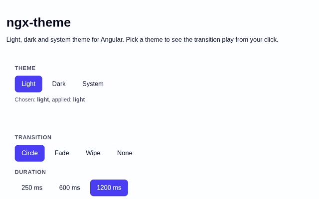
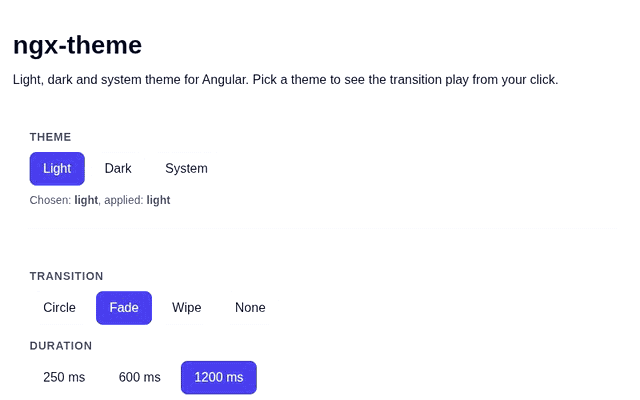
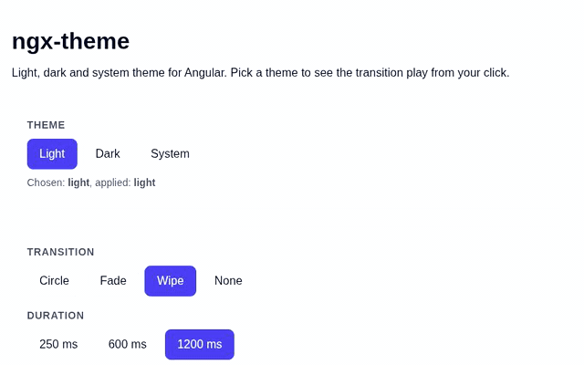

# ngx-theme

[](https://www.npmjs.com/package/@pfm-solutions/ngx-theme)
[](https://github.com/PFM-Solutions/ngx-theme/actions/workflows/ci.yml)
[](https://scorecard.dev/viewer/?uri=github.com/PFM-Solutions/ngx-theme)
[](LICENSE)

Light, dark and system theme for Angular, built on signals. The choice is persisted, system mode follows the OS live, a change reaches every open tab, and an init script applies the theme before the first paint. Picking a theme plays an animated transition from the click.

**[Try the demo](https://pfm-solutions.github.io/ngx-theme/)**

| `circle` (default)                                      | `fade`                                              | `wipe`                                              |
| ------------------------------------------------------- | --------------------------------------------------- | --------------------------------------------------- |
|  |  |  |

## Installation

```bash
npm install @pfm-solutions/ngx-theme
```

Peer dependencies: `@angular/core` and `@angular/common`, version 21 or later.

## Setup

Three pieces: the provider, the stylesheet and the init script.

### 1. Provider

```ts
// app.config.ts
import type { ApplicationConfig } from '@angular/core';
import { provideTheme } from '@pfm-solutions/ngx-theme';

export const appConfig: ApplicationConfig = {
  providers: [provideTheme()],
};
```

`provideTheme()` is the only way to get `ThemeService`: the service is not `providedIn: 'root'`, so injecting it without `provideTheme()` throws a `NullInjectorError`. The provider also starts the service at bootstrap, so OS and cross-tab changes apply even if no component injects it.

### 2. Stylesheet

Import it once in your global styles:

```css
/* styles.css */
@import '@pfm-solutions/ngx-theme/theme.css';
```

It holds the `::view-transition-*` rules of the three transitions and suspends CSS transitions during a switch.

### 3. Init script

The init script applies the stored theme before Angular boots, so a dark page never flashes light on reload. Copy it to your build output with an `assets` entry in `angular.json`:

```json
"assets": [
  { "glob": "theme-init.js", "input": "node_modules/@pfm-solutions/ngx-theme/dist", "output": "/" }
]
```

Then load it as a blocking script in the `<head>` of `index.html` (no `async`, `defer` or `type="module"`):

```html
<head>
  <meta name="color-scheme" content="light dark" />
  <script src="theme-init.js"></script>
</head>
```

With a custom `storageKey`, pass the same key to the script: `<script src="theme-init.js" data-storage-key="app-theme"></script>`.

## Usage

```ts
import { ChangeDetectionStrategy, Component, inject } from '@angular/core';
import { type Theme, ThemeService } from '@pfm-solutions/ngx-theme';

@Component({
  selector: 'app-theme-picker',
  changeDetection: ChangeDetectionStrategy.OnPush,
  template: `
    @for (option of themes; track option) {
      <button
        type="button"
        [attr.aria-pressed]="themeService.theme() === option"
        (click)="themeService.setTheme(option, $event)"
      >
        {{ option }}
      </button>
    }
    <p>Applied: {{ themeService.resolvedTheme() }}</p>
  `,
})
export class ThemePicker {
  protected readonly themeService = inject(ThemeService);
  protected readonly themes: readonly Theme[] = ['light', 'dark', 'system'];
}
```

Pass the click event to `setTheme` to animate the switch from the pointer. Without it, the switch is instant.

## API

### `provideTheme(config?: ThemeConfig): EnvironmentProviders`

Registers `ThemeService` and starts it at bootstrap. See [Configuration](#configuration).

### `ThemeService`

| Member                                                                                           | Description                                                                                         |
| ------------------------------------------------------------------------------------------------ | --------------------------------------------------------------------------------------------------- |
| `theme: Signal<Theme>`                                                                           | Theme chosen by the user: `'light'`, `'dark'` or `'system'`.                                        |
| `resolvedTheme: Signal<ResolvedTheme>`                                                           | Theme applied to the page: `'light'` or `'dark'`, with `system` resolved against the OS preference. |
| `setTheme(theme: Theme, origin?: MouseEvent \| KeyboardEvent \| { x: number; y: number }): void` | Applies and persists `theme`. With an `origin`, the switch plays the configured transition from it. |

`origin` is the triggering event or viewport coordinates. For a pointer click, the animation starts at the pointer; for a keyboard activation (`event.detail === 0`), at the center of the activated element.

### Types

```ts
type Theme = 'light' | 'dark' | 'system';
type ResolvedTheme = 'light' | 'dark';

interface ThemeTransition {
  type: 'circle' | 'fade' | 'wipe';
  duration?: number; // milliseconds
  easing?: string; // CSS easing function
}

interface ThemeConfig {
  storageKey?: string;
  transition?: ThemeTransition | false;
}
```

## Configuration

| Option       | Type                       | Default                                                                       |
| ------------ | -------------------------- | ----------------------------------------------------------------------------- |
| `storageKey` | `string`                   | `'theme'`                                                                     |
| `transition` | `ThemeTransition \| false` | `{ type: 'circle', duration: 600, easing: 'cubic-bezier(0.23, 1, 0.32, 1)' }` |

A partial `transition` is merged with the defaults; `false` disables the animation.

```ts
import { provideTheme } from '@pfm-solutions/ngx-theme';

provideTheme({
  storageKey: 'app-theme',
  transition: { type: 'wipe', duration: 400 },
});
```

## Transitions

| Type     | Effect                                                                      |
| -------- | --------------------------------------------------------------------------- |
| `circle` | The new theme grows as a circle from the origin until it covers the window. |
| `fade`   | Cross-fade between the old and the new theme.                               |
| `wipe`   | The new theme is revealed from left to right.                               |

Transitions use the [View Transitions API](https://developer.mozilla.org/docs/Web/API/View_Transition_API). Only `setTheme` with an `origin` animates. The switch is instant when:

- `setTheme` is called without an `origin`;
- the user prefers reduced motion (`prefers-reduced-motion: reduce`);
- the browser does not support `document.startViewTransition`;
- `transition` is `false`;
- the change comes from the OS or from another tab.

## Behavior

- **On `<html>`**: the `dark` class is set when the resolved theme is dark, and `style.colorScheme` is set to the resolved theme. Style your app from the `dark` class.
- **Storage**: the choice is stored in `localStorage` under `storageKey` as `light`, `dark` or `system`. Nothing is written until the user picks a theme. A missing or unknown value means `system`. If `localStorage` is unavailable (for instance when cookies are blocked), the theme still works but the choice only lasts for the page.
- **System**: in `system` mode, the page follows `prefers-color-scheme` as it changes, without a reload.
- **Tabs**: a change in one tab applies to the other tabs of the same origin. Clearing the storage switches them to `system`.
- **No wave**: during a switch, an attribute on `<html>` disables CSS transitions, so components with `transition-colors` change together instead of one after another.
- **No flash**: the init script and the service apply the same rules, so the page does not change when Angular takes over.

### Tailwind CSS

Tailwind v4 bases `dark:` on `prefers-color-scheme` by default. Point it at the `dark` class:

```css
@import 'tailwindcss';
@import '@pfm-solutions/ngx-theme/theme.css';

@custom-variant dark (&:where(.dark, .dark *));
```

## Compatibility

- Angular 21 and later; CI runs against Angular 21 and 22.
- Animated transitions need View Transitions support ([browser support](https://caniuse.com/view-transitions)). Other browsers switch instantly.
- Browser only: server-side rendering is not supported.

## Contributing

Requirements: Node.js 22.14 or later.

```bash
npm ci
npm run build:lib   # the demo consumes the built library
npm run demo        # demo app on http://localhost:4200
npm test
npm run check       # format, lint and type check
```

`npm run dev` rebuilds the library on change.

1. Branch from `main` as `feat/<topic>`. `main` is protected: every change goes through a pull request with green CI.
2. Write commits as [Conventional Commits](https://www.conventionalcommits.org/) (`feat: add a wipe direction`). Commitlint checks them in CI.
3. If the change touches `src/`, add a changeset with `npx changeset` and describe it for the changelog. For a change under `src/` that must not release, use `npx changeset --empty`.

## Maintenance

### How a release happens

1. Every PR that changes `src/` carries a changeset; CI fails the PR otherwise.
2. On every push to `main`, the `Release` workflow runs the Changesets action. While changesets are pending, it opens or updates the **Version Packages** PR.
3. Merging that PR runs the workflow again: no changeset is left, so it runs `npm run release` (`scripts/release.sh`), which builds the library and runs `npm publish` through npm trusted publishing (OIDC, provenance included, no npm secret), then `changeset git-tag`.
4. The action pushes the `vX.Y.Z` tag and creates the GitHub release from the changelog entry.

If the publish fails, re-run the workflow: the release script skips any version whose tag already exists, and the tag is only created after a successful publish.

### Repository settings

- Settings → Actions → General → enable **Allow GitHub Actions to create and approve pull requests**, or the Version Packages PR cannot be opened.
- A PR opened by `GITHUB_TOKEN` does not trigger the CI. Close and reopen the Version Packages PR to run the required checks.

### First publish

The first version is `0.1.0` (the initial changeset is a minor bump from `0.0.0`). npm cannot attach a trusted publisher to a package that does not exist yet, so a maintainer publishes an empty placeholder once by hand; every real version then goes through CI. The trusted publisher configuration expires if no publish validates it within 2 days of its creation, so run the script right before merging the Version Packages PR.

1. **Bootstrap the package.** Sign in with `npm login` as a member of the `pfm-solutions` org with publish rights and 2FA enabled (npm CLI ≥ 11.15), then from the repo root:

   ```bash
   sh scripts/bootstrap-npm.sh
   ```

   The script refuses to run if the package already exists. It publishes `0.0.0-bootstrap` with the `bootstrap` tag, deprecates it, then runs `npm trust github` for `PFM-Solutions/ngx-theme` and `release.yml`. `--dry-run` only checks the prerequisites and runs `npm publish --dry-run`. npm asks for 2FA along the way.

   The registry may also point `latest` at the placeholder, whatever the tag. The script prints the dist-tags; the `0.1.0` release replaces `latest`.

2. **Merge the Version Packages PR.** The `Release` workflow publishes `0.1.0`, tags `v0.1.0` and creates the GitHub release. Merging it validates the trusted publisher.

3. **Clean up and check.** Remove the stale tag with `npm dist-tag rm @pfm-solutions/ngx-theme bootstrap`, then check that `npm view @pfm-solutions/ngx-theme version` prints `0.1.0` and that the package page shows the provenance badge.

If the 2-day window is missed before the workflow validates the configuration, delete it (`npm trust list`, `npm trust revoke --id=<trust-id>`), create it again with `npm trust github @pfm-solutions/ngx-theme --repo PFM-Solutions/ngx-theme --file release.yml`, and re-run the `Release` workflow (nothing was tagged yet, so the script runs in full).

### Later releases

Close and reopen the Version Packages PR to run the CI, then merge it.

## License

[MIT](LICENSE) © PFM Solutions
